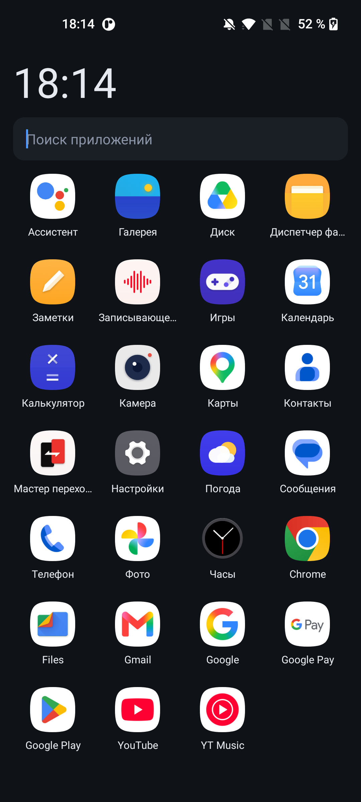
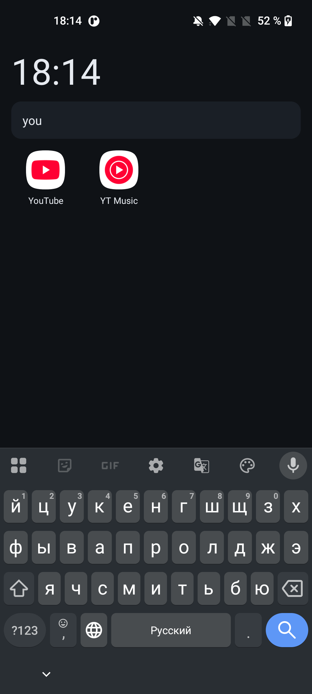
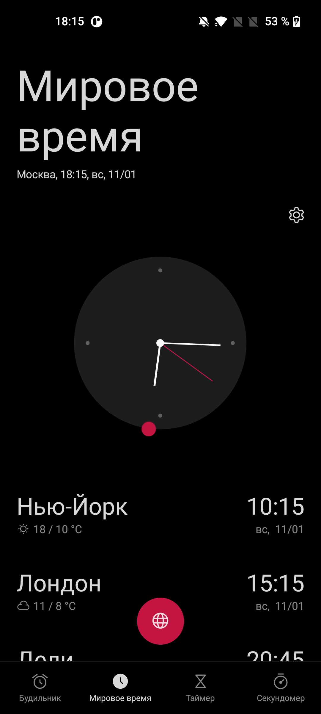

# Mini Launcher

From the creator: Yo, I might be on 4pda soon, and by the way, once I hit 5 downloads, I’m starting a Telegram channel!!!

A home screen for Android with zero third-party libraries. Only `android.*` from the framework,
so the APK is ~29 KB instead of tens of megabytes.

[Русская версия](README.md)

<p align="center">
  
</p>

| Search | Tap the clock to open the Clock app |
|:---:|:---:|
|  |  |

- Package: `io.github.bars2282016.minilauncher`
- minSdk 23 (Android 6+), targetSdk 34
- Language: Java 8, built without Gradle

## Compatibility

- **Minimum: Android 6.0** (API 23, Marshmallow).
- **Target:** Android 14 (`targetSdk 34`).
- **Tested on: Android 11** — OnePlus Nord N10 (BE2029), real device: installation, home screen,
  search, launching apps, uninstalling via long press, tap on the clock.
- Android 6–10 should work too, but has not been tested on real hardware: everything added
  after API 23 is either behind a version check or simply ignored by the system.

## Screenshots

All shots taken on a OnePlus Nord N10 (Android 11):

- [Home screen](docs/screenshot-home.png) — clock, search, app grid
- [Search](docs/screenshot-search.png) — typing "you" leaves only YouTube and YT Music
- [Tap the clock](docs/screenshot-clock.png) — opens the system Clock app

## Features

- Grid of all installed apps; the number of columns adapts to the screen width.
- Alphabetical sorting that respects the locale: in Russian "Ё" goes after "Е", not before "А".
- Search by app name and by package name, right under the clock. The Home button clears the filter.
- Tap an icon to launch; long press for "Open / App info / Uninstall".
- Clock in the header, refreshed every 20 seconds. Tap it to open the system Clock app.
- The list refreshes itself when apps are installed or removed — no full rescan every time you
  return to the home screen.
- Registers as a home screen (`CATEGORY_HOME`), so Android offers it alongside the stock launcher.
  The stock launcher is not removed — you can switch back at any time.

## Layout

```
AndroidManifest.xml                          manifest, minSdk 23, targetSdk 34
res/layout/main.xml                          clock + search + GridView
res/layout/item_app.xml                      icon + label
res/drawable/ic_launcher.xml                 app icon (vector)
src/io/github/bars2282016/minilauncher/      MainActivity, AppEntry
docs/screenshot-home.png                     home screen
docs/screenshot-search.png                   search
docs/screenshot-clock.png                    tap on the clock
build.ps1                                    Gradle-free build
```

## Build requirements

- JDK 17 (looked up in `C:\Program Files\Eclipse Adoptium\jdk-17*`, or pass `-Jdk`).
- Android SDK: `platforms;android-34`, `build-tools;35.0.0` (path via `-Sdk`).

## Building

Important: `aapt2` fails on paths containing non-ASCII characters, so copy the project to a
Latin-only path (e.g. `C:\ml`) and run the script from there.

```powershell
robocopy . C:\ml /E /XD build dist
cd C:\ml
powershell -ExecutionPolicy Bypass -File .\build.ps1
```

Steps inside: `aapt2 compile` → `aapt2 link` → `javac --release 8` → `d8` → inject
`classes.dex` into the APK → `zipalign -f 4` → `apksigner` (creates `debug.keystore` on first run).

Output: `dist\minilauncher-debug.apk`, signed with a debug key (`debug.keystore` is created on the
first run and is not committed).

### Release build

Publishing needs a separate signing key (kept outside the repository, e.g.
`C:\Users\<you>\.android-keys\minilauncher-release.jks`):

```powershell
$env:MINILAUNCHER_KEYSTORE_PASS = "keystore password"
powershell -File .\build.ps1 -Release -Keystore C:\Users\<you>\.android-keys\minilauncher-release.jks `
    -VersionCode 2 -VersionName "1.0.1"
```

Output: `dist\minilauncher-release.apk`.

Keep the key and password outside the repository and never lose them: without them you cannot ship
an update that Android will install over an existing version.

Options: `-Sdk <path>`, `-BuildTools <version>`, `-Platform <android-XX>`, `-Jdk <path>`,
`-VersionCode <N>`, `-VersionName <x.y.z>`, `-Release`, `-Keystore <path>`, `-StorePass <password>`,
`-KeyAlias <alias>`.

## Installation

```powershell
adb install -r dist\minilauncher-debug.apk
adb shell cmd package set-home-activity io.github.bars2282016.minilauncher/.MainActivity
```

The second command makes it the home app right away (Android 10+). Without it, the system asks
when you press Home.

If `adb install` fails with an empty error, disable incremental install:

```powershell
adb install -r --no-incremental dist\minilauncher-release.apk
```

On Android 6–7 enable "Unknown sources" in security settings first; on Android 8+ grant the
permission per app.

## Updating and uninstalling

- Rebuild and `adb install -r` — data is preserved.
- Uninstall: `adb uninstall io.github.bars2282016.minilauncher`.
- Restore the stock launcher:
  ```powershell
  adb shell cmd package query-activities -a android.intent.action.MAIN -c android.intent.category.HOME
  adb shell cmd package set-home-activity <stock.launcher.package>/.<Activity>
  ```

## Permissions and privacy

Permissions:

- `REQUEST_DELETE_PACKAGES` — the system uninstall dialog (Android 11+).
- `com.android.alarm.permission.SET_ALARM` — needed to open the system Clock app when you tap the
  clock in the header. On some ROMs (e.g. OnePlus) `SHOW_ALARMS` throws `SecurityException` without
  it. The permission does nothing else: the launcher never creates alarms.

No `INTERNET` permission: the launcher has no network access and sends nothing anywhere.
No data collection, no analytics.

## License

MIT — see [LICENSE](LICENSE).

Author: Bars2282016
