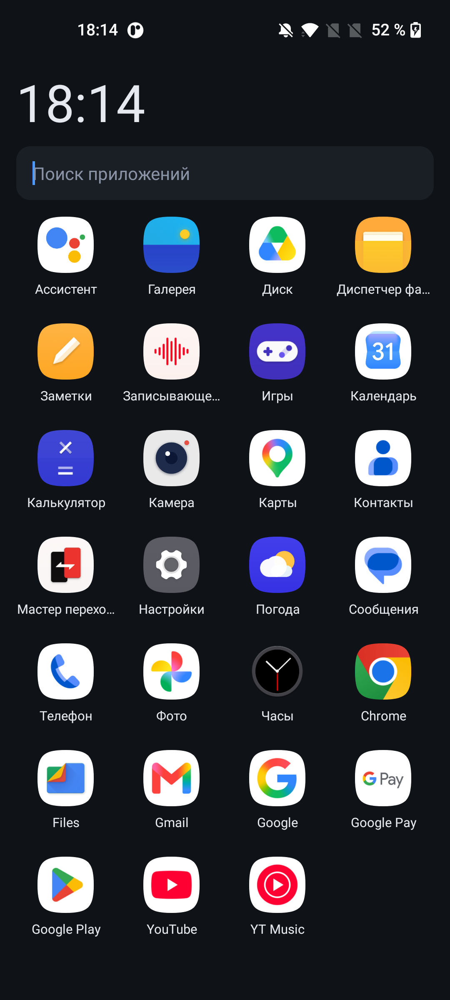
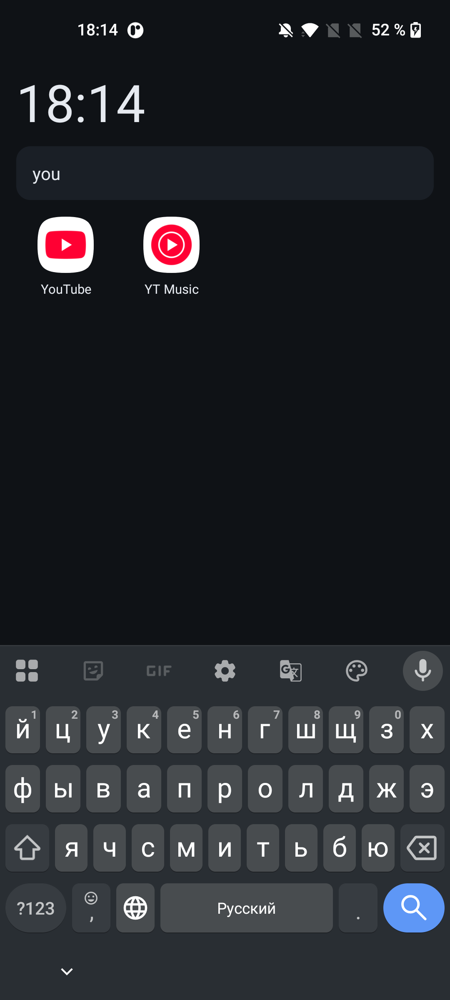
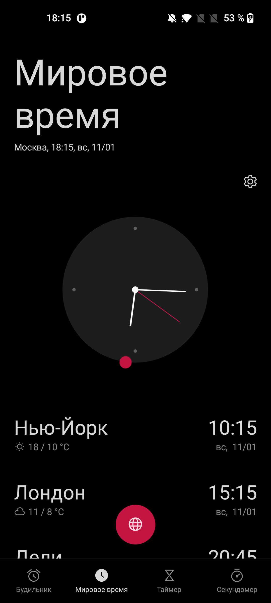

# Мини-лаунчер

Домашний экран для Android без единой сторонней библиотеки. Только `android.*` из фреймворка,
поэтому APK весит ~29 КБ вместо десятков мегабайт.



| Поиск | Тап по часам открывает «Часы» |
|---|---|
|  |  |

- Пакет: `io.github.bars2282016.minilauncher`
- minSdk 23 (Android 6+), targetSdk 34
- Язык: Java 8, сборка без Gradle

## Совместимость

- **Минимум: Android 6.0** (API 23, Marshmallow).
- **Целевая версия:** Android 14 (`targetSdk 34`).
- **Проверено на: Android 11** — OnePlus Nord N10 (BE2029), реальное устройство:
  установка, домашний экран, поиск, запуск приложений, удаление через долгое нажатие,
  тап по часам.
- На Android 6–10 код тоже рассчитан, но вживую не тестировался: всё, что появилось
  позже API 23, либо обёрнуто в проверку, либо просто игнорируется системой.

## Скриншоты

Все снимки сняты на OnePlus Nord N10 (Android 11):

- [Главный экран](docs/screenshot-home.png) — часы, поиск, сетка приложений
- [Поиск](docs/screenshot-search.png) — запрос «you» оставляет только YouTube и YT Music
- [Тап по часам](docs/screenshot-clock.png) — открывается системное приложение «Часы»

## Что умеет

- Сетка всех установленных приложений, число колонок подстраивается под ширину экрана.
- Сортировка по алфавиту с учётом правил локали: «Ё» идёт после «Е», а не перед «А».
- Поиск по названию и по имени пакета — сразу под часами. Кнопка «Домой» сбрасывает фильтр.
- Тап по иконке — запуск; долгое нажатие — «Открыть / О приложении / Удалить».
- Часы в шапке, обновление раз в 20 секунд. Тап по часам открывает системное приложение «Часы».
- Список обновляется сам при установке/удалении приложений — без пересканирования при каждом
  возврате на домашний экран.
- Работает как домашний экран (`CATEGORY_HOME`), поэтому Android предложит выбрать его
  вместо штатного лаунчера. Штатный лаунчер при этом не удаляется — переключиться можно в любой момент.

## Состав

```
AndroidManifest.xml                          манифест, minSdk 23, targetSdk 34
res/layout/main.xml                          часы + поиск + GridView
res/layout/item_app.xml                      иконка + подпись
res/drawable/ic_launcher.xml                 иконка приложения (vector)
src/io/github/bars2282016/minilauncher/      MainActivity, AppEntry
docs/screenshot-home.png                     главный экран
docs/screenshot-search.png                   поиск
docs/screenshot-clock.png                    тап по часам
build.ps1                                    сборка без Gradle
```

## Требования для сборки

- JDK 17 (ищется в `C:\Program Files\Eclipse Adoptium\jdk-17*`, можно указать `-Jdk`).
- Android SDK: `platforms;android-34`, `build-tools;35.0.0` (путь задаётся через `-Sdk`).

## Сборка

Важно: `aapt2` падает на путях с кириллицей, поэтому проект нужно скопировать в путь
из латинских букв (например, `C:\ml`) и запускать скрипт оттуда.

```powershell
robocopy . C:\ml /E /XD build dist
cd C:\ml
powershell -ExecutionPolicy Bypass -File .\build.ps1
```

Шаги внутри: `aapt2 compile` → `aapt2 link` → `javac --release 8` → `d8` → вставка
`classes.dex` в APK → `zipalign -f 4` → `apksigner` (создаёт `debug.keystore` при первом запуске).

Результат: `dist\minilauncher-debug.apk`, подписан отладочным ключом (`debug.keystore` создаётся
при первом запуске и в git не попадает).

### Release-сборка

Для публикации нужен отдельный ключ подписи (лежит вне репозитория, например
`C:\Users\<ник>\.android-keys\minilauncher-release.jks`):

```powershell
$env:MINILAUNCHER_KEYSTORE_PASS = "пароль от ключа"
powershell -File .\build.ps1 -Release -Keystore C:\Users\<ник>\.android-keys\minilauncher-release.jks `
    -VersionCode 2 -VersionName "1.0.1"
```

Результат: `dist\minilauncher-release.apk`.

Ключ и пароль храни отдельно от репозитория и не теряй: без них нельзя выпустить обновление,
которое Android поставит поверх старой версии.

Параметры: `-Sdk <путь>`, `-BuildTools <версия>`, `-Platform <android-XX>`, `-Jdk <путь>`,
`-VersionCode <N>`, `-VersionName <x.y.z>`, `-Release`, `-Keystore <путь>`, `-StorePass <пароль>`,
`-KeyAlias <алиас>`.

## Установка

```powershell
adb install -r dist\minilauncher-debug.apk
adb shell cmd package set-home-activity io.github.bars2282016.minilauncher/.MainActivity
```

Вторая команда сразу делает его домашним экраном (Android 10+). Без неё система сама спросит
при нажатии «Домой».

Если `adb install` падает с пустой ошибкой, помогает отключить инкрементальную установку:

```powershell
adb install -r --no-incremental dist\minilauncher-release.apk
```

На Android 6–7 перед установкой нужно включить «Неизвестные источники» в настройках
безопасности, на Android 8+ — разрешение для конкретного приложения.

## Обновление и удаление

- Пересобрать и `adb install -r` — данные сохраняются.
- Удалить: `adb uninstall io.github.bars2282016.minilauncher`.
- Вернуть штатный лаунчер:
  ```powershell
  adb shell cmd package query-activities -a android.intent.action.MAIN -c android.intent.category.HOME
  adb shell cmd package set-home-activity <пакет штатного лаунчера>/.<Activity>
  ```

## Разрешения и приватность

Разрешения:

- `REQUEST_DELETE_PACKAGES` — системный диалог удаления приложения (Android 11+).
- `com.android.alarm.permission.SET_ALARM` — нужно, чтобы открыть системные «Часы» по тапу
  на часы в шапке. На части прошивок (например, OnePlus) без него `SHOW_ALARMS` падает
  с `SecurityException`. Разрешение ни на что больше не влияет: лаунчер не создаёт будильники.

Разрешения `INTERNET` нет: лаунчер не имеет доступа к сети и ничего никуда не отправляет.
Данные не собираются, аналитики нет.

## Лицензия

MIT — см. [LICENSE](LICENSE).

Автор: Bars2282016
